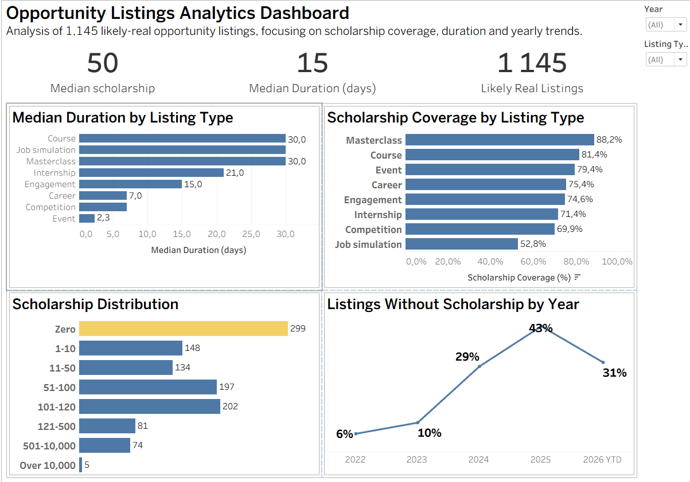

# Opportunity Listings Analytics Dashboard

A data analytics and visualisation project developed from work completed during my **Excelerate Data Visualization Trainee internship** in October–November 2026.

The project involved data profiling, quality assurance, statistical validation and Tableau dashboard development using opportunity-listing data.

**Organisation:** Excelerate  
**Role:** Data Visualization Trainee  
**Internship format:** Remote  
**Period:** October–November 2026  
**Team:** 0510 SLU DVT Team 1  
**Tools:** Tableau, Python, pandas, Google Colab and Excel

> **Project attribution:** This project originated from a team internship. My individual contributions are described separately below. The dashboard presented here is a post-internship portfolio refinement, not the original team submission.

## Dashboard

## Project Objective

The project focused on analysing opportunity-listing data to understand:

- Scholarship distribution across listing types.
- Typical opportunity duration.
- Differences in scholarship coverage between opportunity categories.
- Yearly patterns in listings without scholarship values.

The analysis distinguishes likely-real opportunities from test, placeholder and automation records.

## Dataset Overview

The original dataset contained approximately **5,733 rows and 33 columns**.

The team's cleaned working version contained approximately **5,728 rows and 37 columns**.

| Record classification | Count |
|---|---:|
| Automation QA | 3,851 |
| Test / placeholder | 732 |
| Likely-real listings | 1,145 |
| **Total** | **5,728** |

The portfolio dashboard focuses on the **1,145 likely-real opportunity listings**.

These records represent opportunity listings, not individual applicants or sign-ups.

## My Individual Contributions

### 1. Data Profiling and Quality Assurance

During the first week, I volunteered for the **Data Lead / Profiling** responsibility.

My contributions included:

- Reviewing dataset dimensions and data types.
- Checking missing values and duplicate records.
- Profiling the data and preparing an individual summary.
- Reviewing the team's cleaned workbook and accompanying report.
- Identifying inconsistencies in counts, labels, cleaning order and documentation.
- Communicating corrections and helping improve the accuracy of the final deliverables.

This work strengthened my experience in data quality assurance, source-of-truth validation and analytical documentation.

### 2. Scholarship Analysis and Statistical Validation

I took responsibility for scholarship-distribution analysis and related summary statistics.

I used **Python and pandas in Google Colab**, with AI assistance in the analysis workflow, to reproduce and validate calculations.

Key validated statistics for likely-real listings included:

| Metric | Value |
|---|---:|
| Likely-real listings | 1,145 |
| Non-missing scholarship values | 1,144 |
| Positive scholarship values | 845 |
| Zero scholarship values | 299 |
| Median scholarship | 50 |
| Median positive scholarship value | 100 |
| Median duration | 15 days |

I also reviewed discrepancies in reported scholarship percentages and helped correct the wording of analytical findings.

Scholarship values are presented without currency units because the source data did not clearly document their units.

### 3. Tableau Dashboard Contributions

My primary individual Tableau visualisations were:

**Scholarship Coverage by Listing Type**

A horizontal bar chart comparing the percentage of likely-real listings with scholarship values across opportunity categories.

**Median Duration by Listing Type**

A horizontal bar chart comparing typical opportunity duration across listing categories.

I also contributed to:

- Calculated fields.
- Filtering and dashboard interactivity.
- Tooltip configuration.
- Dashboard testing and quality assurance.
- Presentation preparation.

Other charts in the original internship dashboard were developed as part of the broader team effort. I did not build the entire team dashboard alone.

### 4. Presentation and Reporting

My assigned presentation areas included:

- Key findings and exploratory data analysis.
- Dashboard highlights and visualisations.

I also participated in reviewing the clarity and accuracy of the team's analytical deliverables.

## Key Findings

### Scholarship Coverage by Listing Type

| Listing type | Scholarship coverage |
|---|---:|
| Masterclass | 88.2% |
| Course | 81.4% |
| Event | 79.4% |
| Career | 75.4% |
| Engagement | 74.6% |
| Internship | 71.4% |
| Competition | 69.9% |
| Job simulation | 52.8% |

Masterclasses showed the highest scholarship coverage among the displayed listing categories, while job simulations showed the lowest.

### Median Duration by Listing Type

The overall median duration across likely-real listings was **15 days**.

| Listing type | Median duration (days) |
|---|---:|
| Course | 30 |
| Job simulation | 30 |
| Masterclass | 30 |
| Internship | 21 |
| Engagement | 15 |
| Career | 7 |
| Competition | 7 |
| Event | 2.3 |

Duration values required cleaning and standardisation because the source data contained mixed units.

### Scholarship Distribution

The portfolio dashboard groups scholarship values into the following bands:

| Scholarship band | Listing count |
|---|---:|
| Zero | 299 |
| 1–10 | 148 |
| 11–50 | 134 |
| 51–100 | 197 |
| 101–120 | 202 |
| 121–500 | 81 |
| 501–10,000 | 74 |
| Over 10,000 | 5 |
| **Total across displayed bands** | **1,140** |

The displayed bands provide a descriptive view of the scholarship-value distribution. The difference between this total and the validated non-missing count is discussed in the data quality notes below.

### Listings Without Scholarship by Year

| Year | Share without scholarship |
|---|---:|
| 2022 | 6% |
| 2023 | 10% |
| 2024 | 29% |
| 2025 | 43% |
| 2026 YTD | 31% |

The displayed share increased from 2022 to 2025 before declining in the 2026 year-to-date data.

These are descriptive comparisons. They do not establish causes or explain applicant behaviour.

## Post-Internship Portfolio Refinements

After the internship, I preserved the original team submission and worked on a separate portfolio version of the Tableau dashboard.

I made additional refinements to improve the dashboard's readability, visual consistency and presentation.

These included:

- Adding a clearer dashboard title and explanatory subtitle.
- Introducing three KPI cards.
- Improving chart spacing, borders and visual hierarchy.
- Making chart labels and scholarship bands easier to read.
- Sorting comparison charts for clearer interpretation.
- Improving filter placement and tooltip presentation.
- Standardising typography and field labels.
- Addressing dashboard readability feedback received during the internship.

### Dashboard KPIs

The portfolio dashboard includes three KPI cards:

| KPI | Value |
|---|---:|
| Median scholarship | 50 |
| Median duration | 15 days |
| Likely-real listings | 1,145 |

The dashboard also contains filters for **Year** and **Listing Type**.

The KPI cards represent the overall likely-real dataset rather than recalculating with those filters.

### Final Dashboard Visualisations

The portfolio version presents four main analytical views:

1. **Median Duration by Listing Type** — compares typical opportunity duration.
2. **Scholarship Coverage by Listing Type** — compares scholarship coverage percentages across categories.
3. **Scholarship Distribution** — groups scholarship values into descriptive bands.
4. **Listings Without Scholarship by Year** — compares yearly percentages, including 2026 year-to-date data.

These visualisations combine work from the original team project with subsequent portfolio presentation refinements.

## Data Quality and Interpretation Notes

- The dashboard focuses on likely-real opportunity-listing records, not individual applicants or sign-ups.
- Scholarship units or currency were not clearly documented in the source data, so scholarship values are presented without currency symbols.
- Duration values required cleaning and standardisation because the source data contained mixed units.
- Figures for 2026 are treated as year-to-date data.
- The eight scholarship bands displayed in the portfolio dashboard total **1,140 records**, compared with **1,144 non-missing scholarship values** identified during validation. The Tableau field also contains a `Not stated` category, so the displayed bands should be interpreted as a descriptive view rather than an exhaustive distribution.
- The dashboard presents descriptive findings and should not be interpreted as establishing causal relationships.
- The dataset does not support claims about applicant behaviour or sign-up activity.

## Skills Demonstrated

### Data Analysis and Validation

- Data profiling and quality assurance.
- Descriptive statistics.
- Data validation using Python and pandas.
- Reviewing missing values and duplicate records.
- Scholarship-distribution analysis.
- Source-of-truth and documentation review.

### Data Visualisation

- Tableau dashboard development.
- Dashboard design and visual hierarchy.
- Calculated fields.
- Filters and interactive dashboard elements.
- Tooltips and chart formatting.
- KPI presentation and comparative analysis.

### Professional Skills

- Team collaboration.
- Analytical reporting.
- Quality assurance.
- Presentation and communication.
- Constructive review and feedback.

## Tools and Technologies

| Tool | Application |
|---|---|
| Tableau | Dashboard visualisations, calculated fields, filters and presentation |
| Python | Statistical validation and analysis |
| pandas | Data analysis and validation |
| Google Colab | Python analysis environment |
| Excel | Spreadsheet-based data review and validation |

## Project Context and Attribution

This project originated during my **Excelerate Data Visualization Trainee internship**, working remotely with **0510 SLU DVT Team 1** in October–November 2026.

The original internship deliverables were collaborative.

My principal individual contributions included:

- Data profiling and documentation quality assurance.
- Scholarship-statistics analysis and validation using Python/pandas.
- Tableau visualisations for scholarship coverage and median duration.
- Dashboard filtering, interactivity testing and quality assurance.
- Presentation of analytical findings.

The dashboard shown in this repository includes **additional post-internship refinements completed by me for portfolio presentation**.

The original internship dataset, internal team files and packaged Tableau workbook are not included in this public repository.

## Author

**Azile Gomomo**  
BCom Information Systems Student — University of Johannesburg

- [LinkedIn](https://www.linkedin.com/in/azile-gomomo-520b33366/)
- [GitHub](https://github.com/Azile-cell)
- [Portfolio](https://azile-cell.github.io/Azile-portfolio/)
